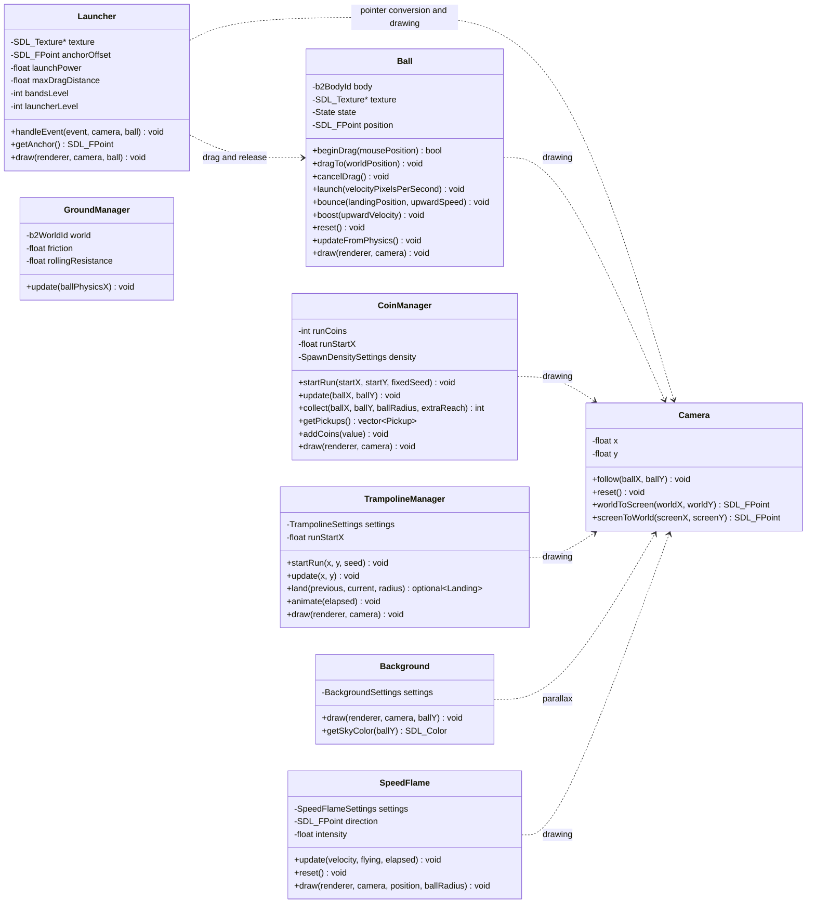
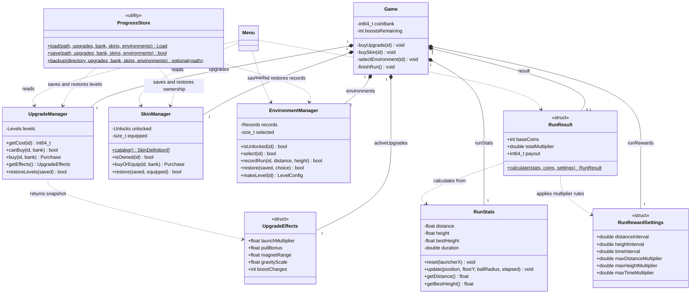
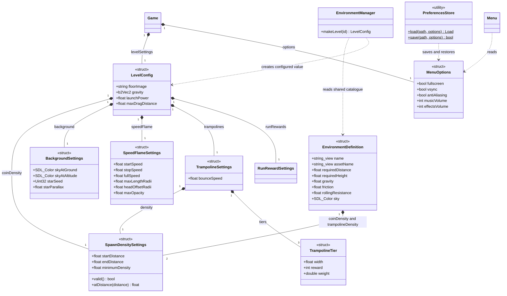

# Protolaunch — implemented UML class diagrams

These views describe the current C++ implementation. Members are selected for
readability: constructors, default arguments, const/reference qualifiers, standard
library containers and nested rendering/callback records are abbreviated or omitted.
Each method name and relationship corresponds to an existing declaration.

**Notation:** `+` public, `-` private, filled diamond (`*--`) composition/ownership,
and dashed arrow (`..>`) a usage dependency. A trailing `$` marks a static method.
`optional` and `vector` abbreviate the corresponding standard library templates.
The views show different parts of the same architecture, not separate designs.

## 1. Application ownership

`Game` owns the application resources and coordinates its systems. Value members
have multiplicity 1; nullable `unique_ptr` members have multiplicity 0..1.
`ProgressStore` and `PreferencesStore` are called as static utilities.

```mermaid
classDiagram
    direction TB
    class Game {
        -Screen screen
        -b2WorldId physicsWorld
        -int64_t coinBank
        +run() int
        -handleEvents() void
        -update(elapsed) void
        -draw() void
        -loadLevel(settings) void
        -resetRun() void
        -finishRun() void
    }
    class Ball {
        +launch(velocityPixelsPerSecond) void
        +updateFromPhysics() void
    }
    class Launcher {
        +handleEvent(event, camera, ball) void
        +configure(sprite, power, pullDistance, bandUpgrade, launcherUpgrade) void
    }
    class GroundManager {
        +update(ballPhysicsX) void
    }
    class CoinManager {
        +update(ballX, ballY) void
        +collect(ballX, ballY, ballRadius, extraReach) int
    }
    class TrampolineManager {
        +update(x, y) void
        +land(previous, current, radius) optional~Landing~
    }
    class Camera {
        +follow(ballX, ballY) void
        +worldToScreen(worldX, worldY) SDL_FPoint
    }
    class Background {
        +draw(renderer, camera, ballY) void
    }
    class SpeedFlame {
        +update(velocity, flying, elapsed) void
        +draw(renderer, camera, position, ballRadius) void
    }
    class RewardEffects {
        +add(screenPosition, value, kind) void
        +update(elapsed) void
    }
    class SoundEffects {
        +play(effect, gain, pitch) void
        +setMusic(music) void
    }
    class Menu {
        +handleEvent(event, view, hasRun, options, upgrades, coinBank, skins, environments) Action
        +update(elapsed) Action
    }
    class UpgradeManager {
        +buy(id, bank) Purchase
        +getEffects() UpgradeEffects
    }
    class SkinManager {
        +buyOrEquip(id, bank) Purchase
    }
    class EnvironmentManager {
        +select(id) bool
        +makeLevel(id) LevelConfig
    }
    class ProgressStore {
        <<utility>>
        +load(path, upgrades, bank, skins, environments) Load$
        +save(path, upgrades, bank, skins, environments) bool$
        +backup(directory, upgrades, bank, skins, environments) optional~path~$
    }
    class PreferencesStore {
        <<utility>>
        +load(path, options) Load$
        +save(path, options) bool$
    }
    Game "1" *-- "0..1" Ball : ball
    Game "1" *-- "0..1" Launcher : launcher
    Game "1" *-- "0..1" GroundManager : ground
    Game "1" *-- "0..1" CoinManager : coins
    Game "1" *-- "0..1" TrampolineManager : trampolines
    Game "1" *-- "1" Camera : camera
    Game "1" *-- "0..1" Background : background
    Game "1" *-- "0..1" SpeedFlame : speedFlame
    Game "1" *-- "0..1" RewardEffects : rewardEffects
    Game "1" *-- "0..1" SoundEffects : sounds
    Game "1" *-- "0..1" Menu : menu
    Game "1" *-- "1" UpgradeManager : upgrades
    Game "1" *-- "1" SkinManager : skins
    Game "1" *-- "1" EnvironmentManager : environments
    Game ..> ProgressStore : calls static functions
    Game ..> PreferencesStore : calls static functions
```

## 2. Gameplay and camera dependencies

Gameplay objects borrow textures owned by `Game`. They use camera conversion
without owning the camera. `Game` steps the Box2D world, forwards trampoline
landings to `Ball::bounce`, and passes pickup events to audio/reward feedback.

## 3. Run state, progression and persistence

Upgrade effects are copied at the start of an attempt. `RunResult` is optional
until a run ends. The bank is a `Game` field, not an instance of a separate
wallet class. Stores load validated data into the existing manager values.

## 4. Configuration and application preferences

Configuration structs are held by value. The environment catalogue is a shared
static array defined in `EnvironmentSettings.cpp`; it is not a scene class.
Application preferences are separate from progression and remain unchanged by
named game loads or Fresh game.

## Implementation notes

- `main.cpp` contains an entry function that constructs `Game`; there is no `Main` class.
- There is no abstract `Scene` base class or inherited menu/gameplay scenes. Application
  navigation uses `Game::Screen`; ball interaction uses `Ball::State`.
- `Menu` owns its UI textures/fonts and receives read-only manager/result references.
  It returns actions and feedback to `Game`; it does not own progression managers.
- `Game` owns the SDL window, renderer and gameplay textures through smart pointers.
  It creates/destroys the Box2D world using its handle. `Ball` owns its body and
  `GroundManager` owns streamed floor bodies; both are released before the world.
- `SpeedFlame` uses supplied velocity and borrowed textures. `RewardEffects` owns
  its font/text cache; `SoundEffects` owns its audio stream and sample/voice data.
- `Game::ProgressDialog` is shared callback state protected by a mutex. It is
  deliberately omitted from the class views, as are `Menu::Button`, `Menu::NineSlice`,
  coin/pickup/platform records and internal audio voices.
- `UpgradeDefinition`, `SkinDefinition` and the sprite rectangle arrays describe
  shared catalogues; they are not separate per-player game objects.

## Source references

- [Application coordinator](../src/Game.h), [entry point](../src/main.cpp) and [menu](../src/Menu.h).
- [Ball](../src/Ball.h), [launcher](../src/Launcher.h), [camera](../src/Camera.h),
  [ground](../src/GroundManager.h), [coins](../src/CoinManager.h) and [trampolines](../src/TrampolineManager.h).
- [Background](../src/Background.h), [speed flame](../src/SpeedFlame.h),
  [reward effects](../src/RewardEffects.h) and [sound](../src/SoundEffects.h).
- [Upgrades](../src/UpgradeManager.h), [skins](../src/SkinManager.h),
  [environments](../src/EnvironmentManager.h), [statistics](../src/RunStats.h) and [results](../src/RunResult.h).
- [Progress store](../src/ProgressStore.h), [preferences](../src/Preferences.h),
  [preferences store](../src/PreferencesStore.h), [level configuration](../src/LevelConfig.h),
  [environment tuning](../src/EnvironmentSettings.cpp) and [spawn-density settings](../src/SpawnDensity.h).
