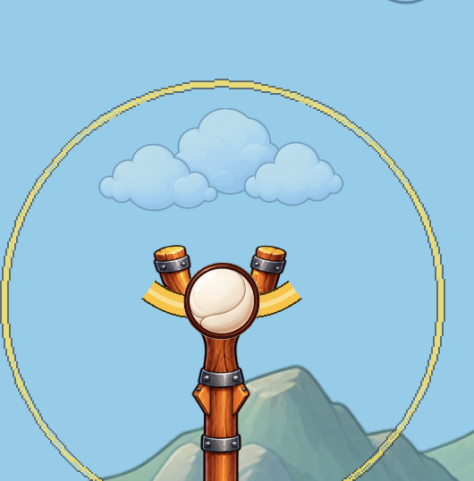
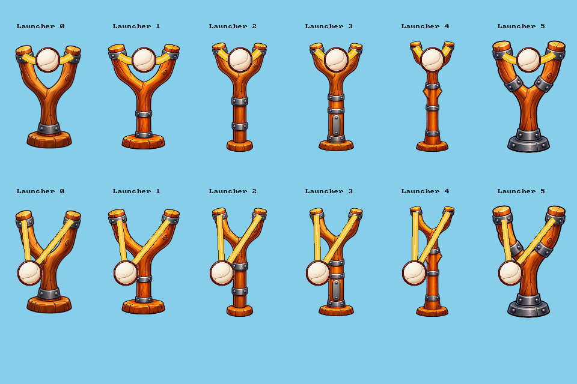
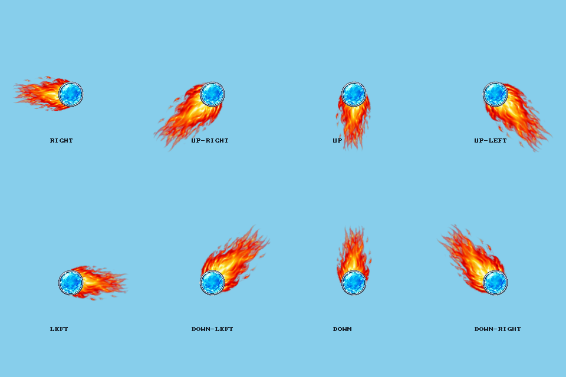
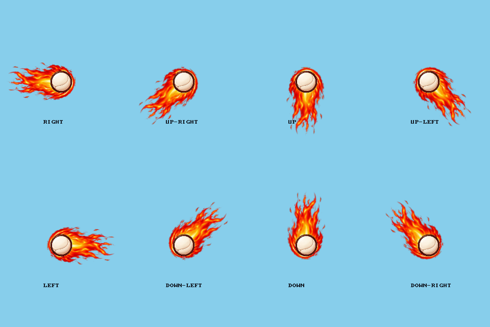
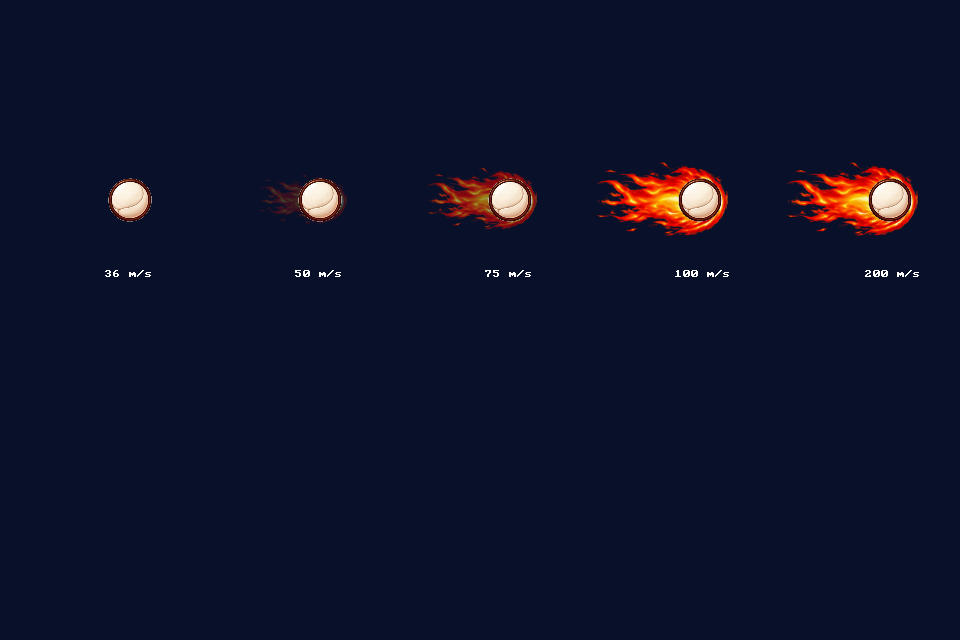

# Protolaunch — Development Report

**Author:** Alex Banfield  
**Module:** COMP3016 — Immersive Game Technologies  
**Repository:** [Bannerz/COMP3016-CW1](https://github.com/Bannerz/COMP3016-CW1)  
**Demonstration video:** 
**Submission version / commit:** 

## 1. Project overview

Protolaunch is a 2D arcade launch-and-upgrade game developed in C++20 using SDL3
and Box2D. The player pulls back an elastic launcher to choose the ball's launch
angle and power, then collects coins and uses trampolines to extend the attempt.
Distance, maximum height and active run time contribute to a final coin payout,
which can be spent on upgrades and cosmetic skins.

The intended audience is players who enjoy accessible arcade controls and
incremental progression. The initial interaction uses a mouse drag and release,
while unlockable air boosts provide limited control during flight. Players can
experiment with their launch, improve their equipment and work towards distance
or height targets that unlock new environments.

The current build includes six environments with different gravity and ground
resistance, streamed coin and trampoline generation, upgrade and skin shops,
results screens, persistent progression and application preferences. Visual and
audio feedback communicate launcher tension, rewards and movement. These systems
extend the original proposal while retaining its central launch-and-upgrade loop.

**Core loop:** launch → collect → finish → receive payout → upgrade → launch again.

### Design focus

My design focus is to make each launch understandable and each attempt contribute
to progression. The player chooses an angle and power, observes the resulting
trajectory and uses earned coins to improve later attempts. Different environment
physics give unlocked areas a different feel, while permanent access allows
players to return to earlier areas.

Feedback should make the ball's movement and rewards easy to read. Animated bands
show the pull, floating values identify coin and trampoline rewards, and a
speed-dependent comet effect communicates fast travel while the camera follows
the ball. Sound reinforces these interactions without being required to understand
them. Distance-based scarcity reduces later coin and trampoline availability,
with the aim of preventing runs from feeling excessively prolonged and keeping
progression dependent on further attempts. The balance and clarity of these
choices remain part of the game's ongoing evaluation.

## 2. Original proposal and design evolution

**Original Week 2 proposal:** [Original Week 2 proposal](COMP3016%20Coursework%201%20-%20Proposal.pdf).

The final game retains the proposed launcher controls, coin collection, trampoline
interactions and upgrade loop. Its scope expanded through multiple environments,
cosmetic progression and more detailed reward and save systems.

| Proposal objective | Delivered implementation | Evolution / discussion |
| --- | --- | --- |
| Mouse-controlled elastic launcher | Angle/power selection, visible bands and pull/release feedback. | Core mechanic retained. |
| Collect coins, bounce and travel further | Coin tiers, three trampoline sizes and distance/height tracking. | Rewards differentiated by value and platform difficulty. |
| Physics, collision and random map generation | Box2D simulation and streamed ground, coins and trampolines. | Random placement on continuous flat terrain rather than varied terrain geometry. |
| Fixed timestep, camera tracking and restart | Fixed 60 Hz physics, two-axis camera and run reset/results flow. | Core technical goals retained. |
| Main menu, gameplay, shop and results | Implemented, with additional options, skins, save/load and environment menus. | Broader navigation and progression scope. |
| Highest score based on distance and height | Distance/height records and payout multipliers, including active run time. | Performance feeds the upgrade economy rather than one combined distance-plus-height score. |
| Upgrades, skins and persistent progression | Upgrade shop, standard/premium skins, autosave, named files and backups. | Progression and persistence expanded. |
| Proposed abstract scene hierarchy | Screen states coordinated by `Game`, shared menu rendering and composed gameplay systems. | Architecture evolved; final UML should represent the delivered design. |
| Backgrounds, animation, particles, music and sound | Parallax scenery, altitude sky colour, animations, reward effects and audio. | An animated high-speed flame trail was added following reported speed-readability feedback; screen shake and advanced launcher deformation remain unimplemented. |
| Obstacles | Coins and helpful trampoline interactions; no dedicated harmful-obstacle system identified. | Omitted because of time constraints; available development time focused on the launch, collection and progression systems. |
| One polished level | Six environments with distinct physics and permanent unlocks. | Expanded replay/progression structure. |

### Reflection on design evolution

The core game remains close to my original proposal: the player launches an
object, collects coins, uses trampolines and purchases upgrades to improve later
attempts. The main changes developed that loop rather than replacing it. In
particular, I expanded the original distance-and-height scoring idea into a coin
payout influenced by distance, maximum height and active run time. My intention
was to make results more interesting by rewarding several aspects of a run and
connecting performance directly to the upgrade economy. This creates more to
consider than a single combined score, although the multipliers and upgrade costs
still need continued balance evaluation.

Chunk loading became necessary to support long runs without retaining an
increasing number of active world objects. Ground, coins and trampolines are
created in nearby regions and unloaded when they are distant. This keeps the
active simulation focused around the ball while allowing travel beyond a fixed
level boundary. Collection and platform-reward history are kept separately so
returning to an area does not award the same objects again. The developer-run
endurance test lasted 19 minutes and 3.1 seconds without slowdown;
comparative performance measurements would provide stronger evidence of the
benefit. Streaming also introduced a collision issue at ground joins, which led
to refinement of the floor's chain geometry.

The architecture evolved from the proposed abstract scene hierarchy into screen
states coordinated by `Game`, with separate classes for gameplay and services.
The application still covers the responsibilities identified in the proposal,
but their organisation differs from the initial UML. Progression also expanded
from one environment into six areas with different physics and unlock targets.
Feedback about unclear speed led to the animated comet effect, while feedback
about overly long runs led to distance-based coin and trampoline scarcity. The
purpose of these changes is clearer feedback and more controlled progression;
the latest balance changes still require a follow-up playtest.

Not every planned visual feature has been implemented. The game includes
procedural band movement, menu transitions, trampoline oscillation and animated
sprite effects, but it does not include screen shake or advanced deformation
such as bending the launcher's mesh under tension. These remain limitations of
the current visual presentation. They are possible future improvements rather
than completed features, and their value should be weighed against readability
and the remaining gameplay refinements.

## 3. Gameplay and mechanics

The [README](README.md#controls) describes the controls and player-facing features.
The following sections explain how the main systems implement that experience.

### Aiming, launching and camera tracking

`Ball` has three interaction states: `Ready`, `Dragging` and `Flying`. A left click
starts a drag only when it is inside the ready ball. `Launcher` converts mouse
coordinates through `Camera::screenToWorld` and clamps the pull to a circle around
the anchor. Releasing uses the displacement back towards the anchor to calculate
velocity; longer pulls produce stronger launches, up to the configured limit.

The release calculation in `Launcher::handleEvent` is:

```cpp
ball.launch({(anchor.x - ballPosition.x) * launchPower,
             (anchor.y - ballPosition.y) * launchPower});
```

`Ball::launch` converts pixels per second to metres per second using 40 pixels per
metre and reverses Y for Box2D's upward-positive coordinates. At the starting
100-pixel pull limit and power of 20, a full pull produces 50 m/s. Mouse capture
supports releasing outside the window; losing focus while dragging cancels the
pull. Once flying, further drag input cannot reposition the ball.

`Camera` subtracts its offset when drawing and adds it when interpreting mouse
positions. It follows horizontally beyond 35% of the viewport and upward beyond
40%, with its offsets clamped at the starting view. This separates camera movement
from physical position and prevents scoring from depending on screen displacement.

### Physics and ground travel

`Game::update` accumulates elapsed time and advances Box2D in fixed 1/60-second
steps, with four solver substeps. Each frame contributes at most 0.25 seconds to
limit catch-up after a delay. This stepping configuration matches the fixed-step
and four-substep guidance in the
[Box2D 3.1.1 simulation documentation (Catto and Box2D contributors, n.d.b)](https://github.com/erincatto/box2d/blob/v3.1.1/docs/simulation.md#simulation).
Menu screens clear the accumulator and do not step
the simulation, so pausing does not accrue run time or produce a large catch-up
when resumed. Rendering runs separately from this fixed-step loop, although body
positions are not interpolated between steps.

The ball is a dynamic circle with friction, restitution and rolling resistance.
Its body is disabled during aiming and enabled on release. Initial angular
velocity depends on horizontal launch speed and is capped for readability; the
rendered sprite then uses the physics body's rotation. Ground material settings
vary by environment. Ground joins use chain geometry with ghost vertices to avoid
exposed collision corners, following the chain-linking approach described in
[Box2D's chain-shape documentation (Catto and Box2D contributors, n.d.b)](https://github.com/erincatto/box2d/blob/v3.1.1/docs/simulation.md#chain-shapes).
Rolling-spin behaviour remains a known presentation
issue, recorded as BALL-01.

### Streamed world generation

`GroundManager` retains five 50-metre floor chunks around the ball's horizontal
position. Coin and trampoline managers retain nearby regions of 960 × 640 pixels,
covering horizontal travel and ascent. Distant active objects are removed instead
of keeping a fully populated, expanding world in memory.

A fresh run seed and region coordinates determine repeatable placements within
that run. Coins have identifiers containing their region and slot; trampolines
use their region as an identifier. Collection and landing history survive active
region unloading, preventing repeated rewards and restoration of trampoline
strength on return. Those history containers can still grow during a long run:
streaming bounds active geometry and nearby objects, rather than guaranteeing
constant total memory use.

Distance-based retention starts thinning candidates at 150 m and reaches minima
of 30% for coins and 5% for trampolines at 1,200 m. The calculation uses candidate
world positions and separate random samples, so backtracking preserves layouts.

### Collection and trampoline interactions

Coin collection uses a squared-distance comparison against the sum of the ball
radius, coin radius and magnet upgrade reach. This avoids a square-root operation
for each proximity check. Weighted selection produces values of 1, 2 or 3; the
Lucky Loot upgrade adjusts those weights. Pickups update one run balance and
provide events for floating labels, particles and sound.

Trampolines use a downward-crossing test between the previous and current ball
positions. Interpolating the crossing position detects landings that could be
missed by checking overlap only at the final position. The ball's centre must
cross over the usable mat width. This is a gameplay interaction rather than a
Box2D trampoline collider; ground collision remains in Box2D.

Green, blue and purple platforms award 3, 7 and 18 coins once per platform per
run. All tiers provide the same initial 35 m/s upward speed, preserving horizontal
motion and spin. Repeat landings on that platform use 75% thrust on the second
landing and 50% thereafter. The visual compression/oscillation does not move the
logical landing surface, keeping collision behaviour predictable.

### Run measurements and payouts

`RunStats` records furthest forward distance, current/maximum height and active
flight time, including rolling. Backtracking and descent do not reduce personal
best measurements. A run ends manually or after 0.75 seconds continuously near
the ground with both velocity components below 0.15 m/s.

`RunResult::calculate` freezes the final measurements and payout. Distance, height
and time factors start at 1, increase linearly and are capped independently:

| Factor | Interval adding 1 | Maximum |
| --- | --- | --- |
| Distance | 400 m | 3 |
| Maximum height | 150 m | 2.5 |
| Active time | 120 s | 1.25 |

Factors and the combined multiplier round to hundredths; the final coin payout
rounds down. The combined cap is 9.38 after rounding. `Game::finishRun` checks
whether a result already exists before banking it, preventing a second award
when navigating results and shops. Records and progression are then autosaved.

### Upgrades, environments and skins

`UpgradeManager` owns six upgrade levels, purchase validation and calculated
effects. Costs double per purchased level, with five levels per upgrade. A
snapshot of the effects is taken when a run resets, so purchases while paused
apply to the next attempt. Air boosts consume a charge and add upward velocity
without removing horizontal motion.

`EnvironmentManager` unlocks an area when either its distance or height target
has been reached in the previous area. Records only increase, preserving access
to earlier unlocks. `EnvironmentSettings.cpp` supplies each area's assets,
physics, targets and scarcity values without duplicating simulation code.
`SkinManager` handles cosmetic ownership and selection; changing a sprite sheet
and source rectangle does not change the ball's collision body or motion.

### Runtime file loading and persistence

Images, fonts and audio are loaded from the runtime assets folder. SDL_image's
[`IMG_LoadTexture` (SDL_image contributors, n.d.)](https://wiki.libsdl.org/SDL3_image/IMG_LoadTexture) loads image
files into textures, while SDL_ttf's
[`TTF_OpenFont` (SDL_ttf contributors, n.d.)](https://wiki.libsdl.org/SDL3_ttf/TTF_OpenFont) loads font files.
Progression
is also read during execution using C++ file streams and `std::filesystem` paths.
`ProgressStore` accepts versions 1–3 of the text `.dat` format, supplying defaults
for skins/environments absent from older versions. It validates labels, ranges,
upgrade levels, ownership and environment records into temporary objects before
replacing live progression. Invalid files leave the current state intact.

Saves write a temporary file before replacing the destination. Named files are
independent from autosave; Fresh game creates a backup before resetting. Loading
a progression file discards the current attempt to avoid carrying its rewards
into another save. `PreferencesStore` separately stores display and audio options,
so loading progression does not replace application preferences. The storage
folder comes from
[`SDL_GetPrefPath` (SDL contributors, n.d.b)](https://wiki.libsdl.org/SDL3/SDL_GetPrefPath), SDL's
user/application-specific writable location.

## 4. Architecture, OOP and programming patterns

### Final UML class diagram

The implemented architecture uses composition: `Game` owns gameplay, presentation
and progression systems. It coordinates enum-driven screens rather than the
abstract scene hierarchy in the proposal. The following overview shows ownership;
[the detailed UML views](docs/uml.md) show gameplay dependencies, progression,
persistence and configuration.

```mermaid
classDiagram
    direction TB
    class Game {
        -Screen screen
        -b2WorldId physicsWorld
        -int64_t coinBank
        +run() int
        -handleEvents() void
        -update(elapsed) void
        -draw() void
        -loadLevel(settings) void
        -resetRun() void
        -finishRun() void
    }
    class Ball {
        +launch(velocityPixelsPerSecond) void
        +updateFromPhysics() void
    }
    class Launcher {
        +handleEvent(event, camera, ball) void
        +configure(sprite, power, pullDistance, bandUpgrade, launcherUpgrade) void
    }
    class GroundManager {
        +update(ballPhysicsX) void
    }
    class CoinManager {
        +update(ballX, ballY) void
        +collect(ballX, ballY, ballRadius, extraReach) int
    }
    class TrampolineManager {
        +update(x, y) void
        +land(previous, current, radius) optional~Landing~
    }
    class Camera {
        +follow(ballX, ballY) void
        +worldToScreen(worldX, worldY) SDL_FPoint
    }
    class Background {
        +draw(renderer, camera, ballY) void
    }
    class SpeedFlame {
        +update(velocity, flying, elapsed) void
        +draw(renderer, camera, position, ballRadius) void
    }
    class RewardEffects {
        +add(screenPosition, value, kind) void
        +update(elapsed) void
    }
    class SoundEffects {
        +play(effect, gain, pitch) void
        +setMusic(music) void
    }
    class Menu {
        +handleEvent(event, view, hasRun, options, upgrades, coinBank, skins, environments) Action
        +update(elapsed) Action
    }
    class UpgradeManager {
        +buy(id, bank) Purchase
        +getEffects() UpgradeEffects
    }
    class SkinManager {
        +buyOrEquip(id, bank) Purchase
    }
    class EnvironmentManager {
        +select(id) bool
        +makeLevel(id) LevelConfig
    }
    class ProgressStore {
        <<utility>>
        +load(path, upgrades, bank, skins, environments) Load$
        +save(path, upgrades, bank, skins, environments) bool$
        +backup(directory, upgrades, bank, skins, environments) optional~path~$
    }
    class PreferencesStore {
        <<utility>>
        +load(path, options) Load$
        +save(path, options) bool$
    }
    Game "1" *-- "0..1" Ball : ball
    Game "1" *-- "0..1" Launcher : launcher
    Game "1" *-- "0..1" GroundManager : ground
    Game "1" *-- "0..1" CoinManager : coins
    Game "1" *-- "0..1" TrampolineManager : trampolines
    Game "1" *-- "1" Camera : camera
    Game "1" *-- "0..1" Background : background
    Game "1" *-- "0..1" SpeedFlame : speedFlame
    Game "1" *-- "0..1" RewardEffects : rewardEffects
    Game "1" *-- "0..1" SoundEffects : sounds
    Game "1" *-- "0..1" Menu : menu
    Game "1" *-- "1" UpgradeManager : upgrades
    Game "1" *-- "1" SkinManager : skins
    Game "1" *-- "1" EnvironmentManager : environments
    Game ..> ProgressStore : calls static functions
    Game ..> PreferencesStore : calls static functions
```



Filled diamonds show owned objects; dashed arrows show static utility calls.
Nullable subsystem pointers are marked 0..1, while manager/camera values are 1.
Selected members are shown; SDL resource types and implementation helpers are
omitted for readability.

### Composition, encapsulation and ownership

`main.cpp` constructs `Game` and calls `run`; application coordination remains
inside `Game`. Gameplay responsibilities are encapsulated behind class methods:
for example, `Launcher` handles the pull calculation, `Ball` manages its body and
interaction state, and the region managers own their active-world data. Internal
containers and state are private, so the coordinator requests actions rather
than modifying those details directly.

The design primarily uses composition. `Game` owns separate gameplay and service
objects instead of deriving them from a common entity or abstract scene base.
This suits a single active launch simulation shared across six configurations.
The environments differ through data rather than separate level subclasses.
It also keeps cosmetic progression separate from physical behaviour.

Resource ownership uses RAII where appropriate, consistent with the
[C++ Core Guidelines R.1 (Stroustrup and Sutter, 2026)](https://isocpp.github.io/CppCoreGuidelines/CppCoreGuidelines#Rr-raii)
recommendation to bind resource management to object lifetime. For example, the texture alias in
`Game.h` attaches SDL's cleanup function to a C++ smart pointer:

```cpp
using TexturePtr = std::unique_ptr<SDL_Texture, decltype(&SDL_DestroyTexture)>;
```

Gameplay objects borrow texture pointers owned by `Game`; they do not free those
textures. Box2D bodies require explicit ordering: `unloadLevel` destroys the ball
and floor bodies before destroying the world, then releases textures. Copying
`Game` and `GroundManager` is disabled to avoid duplicating ownership of those
resources. C++ containers, strings, optional values and file streams manage
application data, while SDL/Box2D C interfaces remain at the library boundaries.

### Game programming approaches

Robert Nystrom's *Game Programming Patterns* provides the terminology for this
comparison. The [Game Loop chapter (Nystrom, 2014b)](https://gameprogrammingpatterns.com/game-loop.html)
describes accumulator-based fixed updates; the
[State chapter (Nystrom, 2014c)](https://github.com/munificent/game-programming-patterns/blob/master/book/state.markdown)
covers finite state machines and the object-based State pattern. The
[Command chapter (Nystrom, 2014a)](https://github.com/munificent/game-programming-patterns/blob/master/book/command.markdown)
provides a comparison for the project's lighter action-enum input routing.

| Approach | Implementation and purpose | Trade-off |
| --- | --- | --- |
| Enum-driven state machines | `Game::Screen` routes screens/actions; `Ball::State` restricts dragging and launching. | Explicit transitions are easy to inspect, but adding screens expands the coordinator's branches. This is not a polymorphic State-class hierarchy. |
| Fixed-step game loop | An accumulator separates physics stepping from variable frame time and pauses simulation in menus. | Consistent step size supports predictable simulation; catch-up is limited and rendering has no position interpolation. |
| Action-based input routing | `Menu` returns an `Action` for `Game` to apply, keeping control hit-testing separate from progression changes. | It is a lightweight action enum, rather than a full Command-object implementation. |
| Composition and configuration | Separate systems operate on one active run; `LevelConfig` and environment definitions supply variation. | Shared simulation avoids duplicated level logic, but changing C++ tuning values still requires a rebuild. |
| Local event hand-off | `CoinManager` exposes recent pickups and trampoline landing returns reward/velocity data; `Game` forwards feedback to visual/audio systems. | This keeps presentation out of collection calculations, but is direct coordination rather than a general event queue. |

These approaches describe the implementation actually present. Region streaming
creates and removes objects; it is not an object pool, and the game does not use
an entity-component framework.

### System coordination and limitations

`Game` reads events, routes gameplay/menu input, advances the simulation, processes
landings and pickups, updates feedback, follows the ball and renders the frame.
The named systems reduce the amount of unrelated logic inside individual methods,
but `Game` still coordinates screens, purchases, native dialogs and persistence
alongside gameplay. That concentration is a maintainability limitation as the
project grows. A later refactor could extract screen transitions or progression
operations while retaining the existing gameplay classes.

The next-run upgrade snapshot is a deliberate consistency choice: the current
simulation keeps its launch/physics settings even when the player shops while
paused. Testing showed that this timing needed clearer communication when buying
before an unlaunched attempt. The implementation is consistent, but the interface
could make the pending effect more explicit.

## 5. Dependencies, assets and runtime delivery

| Dependency | Purpose | Permission / provenance |
| --- | --- | --- |
| C++20 and CMake | Implementation and portable build configuration. | Toolchain details in README. |
| SDL3 | Window, rendering, input, audio and platform services. | Required framework. |
| SDL_image | Runtime sprite/image loading. | SDL companion library |
| SDL_ttf | Runtime font loading and text rendering. | SDL companion library |
| Box2D | Rigid-body physics and collision. | Permission granted by Ji-Jian Chin via email, 27 October 2026, 02:43 (personal communication). |

[Build instructions](README.md#build-and-run) and
[music acknowledgements](README.md#music-acknowledgements).
The build and entry-point setup are documented in SDL's
[CMake integration guide (SDL contributors, n.d.a)](https://wiki.libsdl.org/SDL3/README-cmake) and
[SDL3 entry-point guide (SDL contributors, n.d.d)](https://wiki.libsdl.org/SDL3/README-main-functions).
Menu panels use
[`SDL_RenderTexture9Grid` (SDL contributors, n.d.c)](https://wiki.libsdl.org/SDL3/SDL_RenderTexture9Grid)
for scaling the supplied UI slices.

### Asset provenance and licences

I generated the game sprites, sprite sheets, scenery and UI slices using AI for
Protolaunch, and declare ownership of all rights to these generated visual assets.
Their creation is distinct from the AI-assisted code used to integrate and render
them.

The fonts were obtained from Google Fonts: **Fredoka**, credited to The Fredoka
Project Authors, and **Lilita One**, credited to Juan Montoreano. Both bundled
font packages contain the **SIL Open Font License 1.1**, with their copyright
notices retained in [Fredoka/OFL.txt](src/assets/fonts/Fredoka/OFL.txt) and
[Lilita_One/OFL.txt](src/assets/fonts/Lilita_One/OFL.txt).

Music is credited to The Mountain and HitsLab through the existing
[music acknowledgements](README.md#music-acknowledgements). The eight sound effects
were procedurally synthesised using the project's AI-assisted
`tools/generate-sounds.mjs` script, without external samples.

The [asset provenance table](README.md#asset-provenance-and-licences) consolidates
these sources and links to the bundled font licences.

**Packaged executable instructions:** Pending final Windows release filename,
required runtime components, asset-folder layout and launch instructions.

## 6. Development workflow and refinement

| Repository milestone | Development represented |
| --- | --- |
| [`e07dd94`](https://github.com/Bannerz/COMP3016-CW1/commit/e07dd9474239f814142ac2e9430f041e78cc3feb) — 23 October 2026 | CMake/SDL3/Box2D scaffold. |
| [`cafa814`](https://github.com/Bannerz/COMP3016-CW1/commit/cafa81493e5eb800aec470eef892dac3487704d8) — 24 October 2026 | Assets and slingshot gameplay. |
| [`1611f3f`](https://github.com/Bannerz/COMP3016-CW1/commit/1611f3f1c7058dda8a0f85302ceb270c7b7f70cc) — 25 October 2026 | Camera, coin and ground modularisation. |
| [`347c1aa`](https://github.com/Bannerz/COMP3016-CW1/commit/347c1aa5287d6d786e3eb4f8c60cf0f707cf1cb1) — 27 October 2026 | Application/game-loop refactoring. |
| [`dacfce1`](https://github.com/Bannerz/COMP3016-CW1/commit/dacfce180730110235eda555433f17ab44d55bc7) — 31 October 2026 | Progression, menus and upgrades. |
| [`63cf767`](https://github.com/Bannerz/COMP3016-CW1/commit/63cf767f0b6f7fc789371ee2ce1821fd61944373) — 2 November 2026 | Visual polish. |
| [`bd427c4`](https://github.com/Bannerz/COMP3016-CW1/commit/bd427c47c2c99e0adffd4c10f402fefe2cd2078e) — 2 November 2026 | Audio, save dialogs and progress tests. |

### Implementation dates for referenced APIs and approaches

The dates below come from the first matching committed implementation. They
locate the relevant development work; the Harvard access dates in Section 12
record when the reference pages were checked.

| Referenced API / approach | First committed implementation | Evidence |
| --- | --- | --- |
| CMake setup and SDL application entry point | 23 October 2026 | `e07dd94` — scaffold and `SDL_main.h`. |
| Runtime image loading with `IMG_LoadTexture` | 24 October 2026 | `cafa814` — initial asset/gameplay implementation. |
| Box2D simulation and accumulator-based fixed updates | 24 October 2026 | `cafa814` — `b2World_Step` and accumulator logic. |
| Chain geometry for ground collision | 27 October 2026 | `347c1aa` — `b2CreateChain`. |
| RAII texture ownership | 27 October 2026 | `347c1aa` — texture `std::unique_ptr` ownership. |
| Screen enums and menu action routing | 31 October 2026 | `dacfce1` — `Screen` and menu `Action` declarations. |
| Nine-slice UI, preference paths and font loading | 31 October 2026 | `dacfce1` — `SDL_RenderTexture9Grid`, `SDL_GetPrefPath` and `TTF_OpenFont`. |
| Gameplay refinements and report/reference work | 4–5 November 2026 | [Refinement snapshot and evidence](#refinement-snapshot). |

The linked commits show successive delivery from the project scaffold through
playable mechanics, modularisation, progression and presentation. They also show
the architecture evolving during implementation rather than appearing only as a
final upload. The latest gameplay refinements and report work are linked through
the evidence below.

<a id="refinement-snapshot"></a>

**Refinement snapshot commit:** to be added after the first snapshot commit.
This reference will identify the source and evidence recorded by the current
report; the submission version at the top will identify the final delivered build.

**Refinement case study — ground seams:** unexpected upward bounces during long
rolls led to continuous chain contact geometry with ghost vertices. The
[README retrospective](README.md#retrospective-ground-chunk-seam-bounce) describes
the change. In [DEV-04](#dev-04), the developer observed no unexpected seam bounce
across multiple chunks; [DEV-15](#dev-15) records acceptance of the separate
rolling-spin defect as a known limitation. The implementation is in
[`GroundManager.cpp`](src/GroundManager.cpp).

**Further refinement evidence:** [LAUNCHER-01](#launcher-01) includes before/after
images and explains the per-sprite collar correction. The
[comet refinement](#comet-refinement) includes direction/growth captures;
[initial scarcity](#initial-scarcity) and the [final balance pass](#final-balance)
record the progression changes and automated checks. [DEV-15](#dev-15) records
final developer acceptance. Quantitative balance comparisons and a structured
external retest were not recorded.

## 7. AI use and integration

AI assistance supported explanations, architecture, implementation,
debugging, documentation and verification. Design direction, feature requirements
and development feedback are documented alongside those contributions in the
[AI development log](AI_DEVELOPMENT_LOG.md).

### Representative requests, review and integration

The following request summaries link to the existing AI log and supporting report
evidence. They summarise the requests rather than reproduce verbatim prompts.

| Request summary | Output review and refinement | Verification / repository evidence |
| --- | --- | --- |
| Investigate bands failing to align on the level-4 launcher and check the other upgrades. | Shared attachment coordinates did not fit different artwork; per-sprite collar coordinates replaced them while keeping band style independent. | [LAUNCHER-01](#launcher-01): before/after captures, combination checks and developer feedback; [source](src/Launcher.cpp), [AI-21](AI_DEVELOPMENT_LOG.md#ai-21--launcher-band-attachment-correction). |
| Add a trajectory-aligned flame to communicate speed, then wrap its leading edge around the ball and scale it with speed. | The first version communicated speed, but my screenshot feedback led to a forward head offset and smoothed, bounded opacity/size. | [Comet refinement](#comet-refinement): eight-direction and capped-growth captures; [source](src/SpeedFlame.cpp), [AI-23](AI_DEVELOPMENT_LOG.md#ai-23--speed-feedback-flame) and [AI-24](AI_DEVELOPMENT_LOG.md#ai-24--comet-envelope-and-speed-based-growth). |
| Reduce excessively long runs and lower payouts. | Initial scarcity was followed by earlier thinning, weaker repeat bounces, increased ground resistance and lower reward multipliers. Starting launch and upgrade prices were retained. | [Balance tests](tests/BalanceTests.cpp), [2/2 CTest result and tuning](#final-balance), [final developer acceptance](#dev-15); [AI-25](AI_DEVELOPMENT_LOG.md#ai-25--distance-based-resource-scarcity) and [AI-26](AI_DEVELOPMENT_LOG.md#ai-26--shorter-runs-and-lower-payouts). |

The [refinement snapshot reference](#refinement-snapshot) will connect these
examples to their commit. The [milestone history](#6-development-workflow-and-refinement)
provides earlier repository evidence; the complete
[AI development log](AI_DEVELOPMENT_LOG.md) records the wider contribution history.

**Tools / access details:** ChatGPT was used. Its
contributions, integration and verification are documented in the
[AI Development Log](AI_DEVELOPMENT_LOG.md).

**Signed Generative AI Declaration:** [signed Generative AI Declaration](Generative%20AI%20Tool%20declaration.pdf) — Partnered Work (P1), signed and dated 4 November 2026.

## 8. Testing, robustness and performance

The [testing checklist](README.md#testing-and-playtesting) defines 81 planned cases.
Completed executions and observations are documented separately from the plan.

| Area | Current evidence | Results / supporting reference |
| --- | --- | --- |
| Windows portability | Developer tested on Windows 10 using Visual Studio Professional 2022 on 1 November 2026. Compilation and execution succeeded; Release compiled without errors and ran outside Visual Studio. | WIN-01 below. Exact tested commit and hardware were not recorded; final-build and SMB102 verification remain outstanding. |
| Automated persistence and balance checks | `tests/ProgressStoreTests.cpp` covers persistence/failure cases; `tests/BalanceTests.cpp` covers repeat bounces, payouts and environment settings. | AI-run macOS CTest passed 2/2 on 4 November 2026; see the final balance refinement below. |
| Unexpected input and menu transitions | Developer-run launcher checks passed, including empty-space input and drag cancellation. | Session DEV-01 below; wider input/transition cases remain planned. |
| Physics and streaming | Developer observed no unexpected seam bounces across multiple ground chunks; loss of rolling spin was reproduced. | DEV-04 below; BALL-01 is retained as an accepted known limitation in DEV-15. |
| Payouts and progression | Results-navigation/reset checks, affordable/unaffordable purchases and environment selection/revisiting passed in developer testing. | DEV-02 and DEV-06; exact payout and unlock boundaries remain planned. |
| Performance / endurance | A 1,143.1-second single run completed without reported crashes, freezes, noticeable slowdown or glitches. | DEV-14; frame-rate/memory measurements and repeated-reset endurance remain unmeasured. |

<a id="win-01"></a>

### Windows build and standalone execution WIN-01 — 1 November 2026

**Tester:** Alex Banfield (developer)  
**Platform:** Windows 10  
**Toolchain:** Visual Studio Professional 2022  
**Evidence:** developer-reported results; test details confirmed on 4 November 2026

| Check | Actual observation | Result |
| --- | --- | --- |
| Open the project, allow dependency setup and build/run in Visual Studio. | Dependencies configured and the game compiled and ran successfully. | Pass |
| Compile a Release build. | Release compiled without errors. | Pass |
| Run the Release executable outside Visual Studio. | The standalone Release executable ran successfully. | Pass |

The exact tested commit and hardware were not recorded. This confirms Windows
build/run and standalone execution for the version tested on 1 November; it does
not verify subsequent changes. A final-version Windows check and SMB102 testing
remain outstanding.

### Exception and failure handling

`main` catches `std::exception`, logs the startup/runtime error through SDL and
returns a nonzero exit status. This reports C++ exceptions; it does not catch
arbitrary memory faults. Owned resources are released by destructors, with level
bodies destroyed before the Box2D world. Invalid configuration and sprite bounds
are rejected rather than passed into gameplay unchecked.

`ProgressStore::load` parses and validates candidate state before applying it,
so malformed input does not partially replace progression. Save operations use a
temporary file and report failure. Cancelling native dialogs leaves progression
unchanged, and Fresh game requires a successful backup before resetting.
Purchase handling can roll back progression when persistence fails. Audio setup
can fail without preventing gameplay. These are explicit error-handling paths,
not a claim that every possible failure is covered; the session records below
and automated checks identify the exercised cases.

<a id="dev-01"></a>

### Developer test session DEV-01 — 4 November 2026

**Tester:** Alex Banfield (developer)  
**Platform:** macOS 27  
**Build:** development build  
**Repository context:** working tree based on `bd427c4`, with local changes  
**Evidence:** developer observations supplied in the testing conversation

| Check | Checklist reference | Actual observation | Result |
| --- | --- | --- | --- |
| Open the game and select Play. | B01, launch/play check | Game opened and Play worked normally. | Pass |
| Click and drag on empty space. | L02, empty-space check | Ball stayed still. | Pass |
| Release a short pull. | L01, short-pull check | Ball launched opposite the pull. | Pass |
| Compare a full pull with the short pull. | L01, launch-power comparison | Full pull produced a noticeably stronger launch. | Pass |
| Pull beyond the allowed distance. | L03, maximum-pull check | Ball remained within its pull limit. | Pass |
| Press Escape while dragging, then resume. | L05, drag-cancellation check | Ball returned to the launcher and remained usable. | Pass |

All six reported checks passed. These results cover the specific scenarios above;
other variants within the broader checklist cases remain to be tested.

<a id="dev-02"></a>

### Developer test session DEV-02 — 4 November 2026

**Tester / platform / build:** Alex Banfield; macOS 27; development build, continuing DEV-01.  
**Evidence:** developer observations supplied in the testing conversation.

| Check | Checklist reference | Actual observation | Result |
| --- | --- | --- | --- |
| Pause during flight for approximately five seconds, then resume. | L05, flight-pause check; R02, paused-time check | Ball froze while paused and the run timer excluded the paused interval after resuming. | Pass |
| Press R during flight. | L06, launched-run ending check | Results screen appeared. | Pass |
| Visit Shop from Results and return without purchasing. | R01, results-navigation check | Bank balance remained unchanged. | Pass |
| Select Play again and inspect the HUD before launch. | R01, new-run reset check | Run coins, distance, maximum height and run time reset to zero. | Pass |

All four reported checks passed. No fixes or retests were required for this batch.

<a id="dev-03"></a>

### Developer test session DEV-03 — 4 November 2026

**Tester / platform / build:** Alex Banfield; macOS 27; development build, continuing DEV-01/DEV-02.  
**Evidence:** developer observations supplied in the testing conversation.

| Check | Checklist reference | Actual observation | Result |
| --- | --- | --- | --- |
| Collect a 1-value coin. | C01, 1-value pickup | Counter increased by 1 and a gold +1 label appeared. | Pass |
| Collect 2- and 3-value coins. | C01, 2/3-value pickups | Counter increases and floating labels matched both coin values. | Pass |
| Observe reward labels and sparks after collection. | C05, feedback lifetime | Feedback rose/faded away without lingering. | Pass |
| Compare coin layouts across three new runs. | C03, new-run variation | Layout changed between runs. | Pass |
| Use an unlocked Coin Magnet. | C04, upgraded pickup check | Range outline appeared and coins could be collected without direct ball contact. | Pass |

All five reported checks passed. This batch did not measure every magnet level or
its exact collection boundary, or verify coin generation at extreme distances/heights.

<a id="dev-04"></a>

### Developer test session DEV-04 — 4 November 2026

**Tester / platform / build:** Alex Banfield; macOS 27; development build, continuing prior sessions.  
**Evidence:** developer observations supplied in the testing conversation.

| Check | Checklist reference | Actual observation | Result |
| --- | --- | --- | --- |
| Land on a green trampoline. | T01, green reward/feedback | Upward bounce, 5 run coins and mint +5 feedback worked. | Pass |
| Land on blue and purple trampolines. | T01, blue/purple rewards | Both types were tested; +10 and +25 rewards/feedback worked. | Pass |
| Observe trampoline compression and settling. | T04, single-bounce animation | Trampoline compressed/oscillated and returned to rest. | Pass |
| Observe spin and slowing after ground contact. | P01, rolling-spin check | Ball appeared to stop spinning after ground contact; spin appeared to resume after another trampoline bounce. Slowing was not separately confirmed. | Fail — BALL-01 |
| Observe a long ground roll after initial impact, away from trampoline contact. | P02, observed seam regression | No unexplained upward kicks were observed over more than a few ground chunks. Exact duration/distance and speed/surface variants were not measured. | Pass for observed run |

**Known limitation BALL-01 — rolling spin:** ground contact can leave the ball
visibly sliding without continued rotation. The renderer uses the Box2D body
angle; contact friction and rolling resistance are investigation points, not a
confirmed cause. Following final playtesting, I chose to retain this defect in
the submitted version. It is accepted as a known limitation, not a resolved or
passed regression. Ground seam geometry was not changed during this session.

<a id="dev-05"></a>

### Developer test session DEV-05 — 4 November 2026

**Tester / platform / build:** Alex Banfield; macOS 27; development build, continuing prior sessions.  
**Evidence:** developer observations supplied in the testing conversation.

| Check | Checklist reference | Actual observation | Result |
| --- | --- | --- | --- |
| Note bank balance, upgrades and equipped skin; quit normally and reopen. | S01, restart persistence | The noted balance, upgrade levels and equipped skin were restored. | Pass |
| Create a named file using Save as. | S02, named-file creation | Save appeared at the selected destination. | Pass |
| Change progression, then load the named file. | S02, named-file restoration | Saved state was restored after the intervening change. | Pass |
| Open a save/load dialog and cancel. | S03, dialog cancellation | Game remained usable and progression stayed unchanged. | Pass |

All four reported checks passed. Invalid files, overwrite handling, backup recovery
and failure-path behaviour were not exercised in this batch.

<a id="dev-06"></a>

### Developer test session DEV-06 — 4 November 2026

**Tester / platform / build:** Alex Banfield; macOS 27; development build, continuing prior sessions.  
**Evidence:** developer observations supplied in the testing conversation.

| Check | Checklist reference | Actual observation | Result |
| --- | --- | --- | --- |
| Buy an affordable upgrade. | U01, purchase accounting | Displayed price was deducted and the upgrade level increased once. | Pass |
| Attempt an unaffordable upgrade. | U02, insufficient-funds check | Bank balance and upgrade level remained unchanged. | Pass |
| Attempt to select a locked environment. | E01, locked-selection check | Area stayed locked and could not be selected. | Pass |
| Select an unlocked environment and start a new run. | E05, selected-area launch | Scenery and HUD environment name matched the selection. | Pass |
| Return to Yard and start another run. | E04, revisiting check | Yard worked and previously unlocked environments remained available. | Pass |

All five reported checks passed. Exact unlock thresholds, every upgrade effect,
maximum-level purchases and paused-run selection were not tested in this batch.

<a id="dev-07"></a>

### Developer test session DEV-07 — 4 November 2026

**Tester / platform / build:** Alex Banfield; macOS 27; development build, continuing prior sessions.  
**Evidence:** developer confirmed all five checks passed in the testing conversation.

| Check | Checklist reference | Actual observation | Result |
| --- | --- | --- | --- |
| Toggle fullscreen on and off and use menu buttons. | M04, fullscreen/input check | Display changed correctly and button hit areas remained aligned. | Pass |
| Toggle anti-aliasing off and on. | M04, anti-aliasing check | Gameplay continued without broken rendering. | Pass |
| Mute music while leaving effects enabled. | M05, independent music mute | Music muted while gameplay effects remained audible. | Pass |
| Restore music and mute effects. | M05, independent effects mute | Gameplay and menu effects muted while music continued. | Pass |
| Restore both volume channels. | M05/M06/M07, audio restoration check | Sounds returned normally, without duplicate music or stuck pulling/rolling loops during the observed check. | Pass |

All five reported checks passed. VSync timing, all volume increments and extended
audio-transition/endurance checks were not measured in this batch.

<a id="dev-08"></a>

### Developer test session DEV-08 — 4 November 2026

**Tester / platform / build:** Alex Banfield; macOS 27; development build, continuing prior sessions.  
**Evidence:** developer confirmed all four checks passed in the testing conversation.

| Check | Checklist reference | Actual observation | Result |
| --- | --- | --- | --- |
| Navigate menus with arrow keys or Tab and activate with Enter. | M01, keyboard navigation | Buttons could be selected and activated correctly. | Pass |
| Click Play and rapidly click again during its closing animation. | M02, repeated-input check | One run started without accidentally dragging or launching the ball. | Pass |
| Switch to another application while dragging, then return. | L04, drag focus-loss check | Drag was safely cancelled and the game remained usable. | Pass |
| Switch applications during flight, return and resume. | L05, focus-loss pause check | Game paused and resumed without the ball jumping forward. | Pass |

All four reported checks passed. This batch did not cover every menu transition,
keyboard shortcut or release outside the window.

<a id="dev-09"></a>

### Developer test session DEV-09 — 4 November 2026

**Tester / platform / build:** Alex Banfield; macOS 27; development build, continuing prior sessions.  
**Evidence:** developer observations supplied in the testing conversation.

| Check | Checklist reference | Actual observation | Result |
| --- | --- | --- | --- |
| Observe the sky during a high flight. | P06, altitude presentation | Sky gradually darkened and stars appeared. | Pass |
| Observe stars while the camera moves. | P06, starfield stability | Stars moved smoothly without flickering or randomly changing position. | Pass |
| Descend from high altitude. | P06, descending sky transition | Sky brightened and stars faded away. | Pass |
| Observe camera movement and visible mountain bases during ascent/descent. | P05/P06, camera/scenery alignment | Camera followed both directions correctly and mountains stayed attached to the ground when visible. | Pass |
| Compare current and maximum height on descent. | R03, height tracking | Current height decreased while maximum height retained the highest value reached. | Pass |

All five reported checks passed. The environment used and coverage of the other
five environment variants were not specified in this batch.

<a id="dev-10"></a>

### Developer test session DEV-10 — 4 November 2026

**Tester / platform / build:** Alex Banfield; macOS 27; development build, continuing prior sessions.  
**Evidence:** developer observations supplied in the testing conversation.

| Check | Checklist reference | Actual observation | Result |
| --- | --- | --- | --- |
| Equip a different owned skin. | U06, free equip check | Appearance changed without deducting coins. | Pass |
| Buy an affordable locked skin. | U06, skin purchase check | Displayed price was deducted once and the skin unlocked/equipped. | Pass |
| Browse standard and ultra-premium collections and pages. | U05, browsing check | Previews and page navigation worked correctly. | Pass |
| Press Up during flight with Air Boost unlocked. | P08/U03, boost activation | Upgrade was purchased during an existing attempt before launch. It applied on the next new run, where Up added upward speed and consumed one charge. | Pass — next-run application confirmed |
| Exhaust boost charges, press Up again and start a new run. | P08, charge limits/refill | Exhausted charges prevented further boosts and charges refilled on a new run. | Pass |

The developer clarified that Air Boost was purchased during an existing attempt
before the ball had launched. Its effect became available on the next new run,
matching the upgrade snapshot taken when an attempt starts. All five checks in
this batch therefore passed.

**Usability observation:** next-run upgrade timing was initially unclear when
purchasing before launch. Clearer wording distinguishing a new attempt from an
unlaunched ball is a possible refinement; no UI change has been applied yet.

<a id="dev-11"></a>

### Developer test session DEV-11 — 4 November 2026

**Tester / platform / build:** Alex Banfield; macOS 27; development build, continuing prior sessions.  
**Evidence:** developer observations supplied in the testing conversation.

| Check | Checklist reference | Actual observation | Result |
| --- | --- | --- | --- |
| Let the ball settle on the ground without pressing R. | R04, natural ending | Results appeared automatically after the ball settled. | Pass |
| Observe normal landing bounces before rest. | R04, premature-ending check | Run continued during landing bounces rather than ending early. | Pass |
| Finish a run with no coin or trampoline rewards. | R04, zero-reward check | Final payout was zero. | Pass |

All three reported checks passed. The exact 0.75-second rest interval was not
measured; these observations verify the visible run-ending behaviour.

<a id="dev-12"></a>

### Developer test session DEV-12 — 4 November 2026

**Tester / platform / build:** Alex Banfield; macOS 27; development build, continuing prior sessions.  
**Evidence:** developer observations supplied in the testing conversation.

| Check | Checklist reference | Actual observation | Result |
| --- | --- | --- | --- |
| Open Fresh game and cancel. | S10, reset cancellation | Progression remained unchanged. | Pass |
| Confirm Fresh game after keeping a named save. | S10, starter reset | Coins/upgrades reset, starter skins returned and only Yard remained unlocked. | Pass |
| Observe reset completion feedback. | S10, backup notification | Game reported that previous progression was backed up. | Pass — notification observed |
| Load the retained named save after resetting. | S02/S10, named-save recovery | Previous coins, upgrades, skins and environment unlocks were restored. | Pass |

All four reported checks passed. The generated backup file was not independently
opened or restored in this batch; recovery used the retained named save. Unique
backup naming and backup/write failure paths remain separate checks.

<a id="dev-13"></a>

### Developer test session DEV-13 — 4 November 2026

**Tester / platform / build:** Alex Banfield; macOS 27; development build, continuing prior sessions.  
**Evidence:** developer observations supplied in the testing conversation.

| Check | Checklist reference | Actual observation | Result |
| --- | --- | --- | --- |
| Attempt to load an invalid .dat file containing unrelated text. | S05, unrelated-content rejection | Game displayed an error without crashing. | Pass |
| Inspect progression after the rejected load. | S05, session preservation | Coins, upgrades, equipped skin and selected environment remained unchanged. | Pass |
| Load a valid named save after the failed attempt. | S02/S05, recovery after invalid input | Valid save loaded normally. | Pass |

All three reported checks passed. This verifies the unrelated-text case; empty,
truncated, unsupported-version and structurally invalid progression files remain
separate cases.

<a id="dev-14"></a>

### Developer test session DEV-14 — 4 November 2026

**Tester / platform / build:** Alex Banfield; macOS 27; development build, continuing prior sessions.  
**Duration:** one continuous run lasting 1,143.1 seconds (19 minutes 3.1 seconds), ended manually.  
**Evidence:** developer-reported run duration and observations supplied in the testing conversation.

| Check | Checklist reference | Actual observation | Result |
| --- | --- | --- | --- |
| Observe responsiveness throughout a long run. | Q01, single-run endurance | No crash, freeze or noticeable slowdown was reported. | Pass for observed run |
| Observe world generation and visual/audio behaviour during extended travel. | Q01, long-run presentation/streaming | Developer reported no glitches and that the game worked as expected throughout. | Pass for observed run |
| End the extended run manually. | L06/R01, extended-run termination | Developer manually ended the run after 1,143.1 seconds. The ending control and results/payout details were not specified. | Manual termination observed |

This session covers one long run rather than repeated resets and menu/resource
cycling. Frame rate, memory use, environment and distance were not recorded;
performance conclusions are based on observed responsiveness. The absence of new
glitches does not resolve the previously recorded rolling-spin issue BALL-01.

<a id="dev-15"></a>

### Final developer playtest DEV-15 — 4 November 2026

**Tester:** Alex Banfield (developer)  
**Build context:** current development version following the final balance changes  
**Evidence:** developer confirmation that final playtesting was successful

| Review | Actual outcome | Status |
| --- | --- | --- |
| Final developer playtest following the latest gameplay refinements. | I confirmed that playtesting was successful, following my earlier feedback that the revised balance felt much better. | Pass — overall developer acceptance |
| Disposition of the previously recorded rolling-spin defect. | I chose to leave BALL-01 unfixed in this version. | Accepted known limitation |

This is an overall developer acceptance result. No additional per-case results,
run-duration/earnings measurements or external participant records were supplied.
It does not replace the separate final Windows build check or mark BALL-01 as
fixed. The detailed earlier session records remain unchanged.

<a id="launcher-01"></a>

### Visual regression LAUNCHER-01 — 4 November 2026

**Developer observation:** procedural bands did not align with the upgraded
launcher artwork, particularly level 4. The supplied screenshot shows the band
ends floating outside/below the fork collars.

**Cause:** every sprite used the same normalised attachment coordinates, despite
having different fork widths and heights. Band style was selected by the Bands
upgrade, but attachment geometry did not vary with the Launcher upgrade.

**Change:** each of the six equipped launcher sprites now has its own left/right
collar coordinates. Launcher level selects the attachment geometry independently
of band level, which continues to control colour and thickness. Launch origin,
maximum pull behaviour and physics were retained.

| Verification | Outcome | Source |
| --- | --- | --- |
| Initial level-4 alignment observation. | Fail — LAUNCHER-01 | Developer screenshot. |
| Compile the updated game on macOS. | Pass | AI-run build. |
| Render all six sprites at rest and while pulled, using the widest bands. | Attachment points visually inspected against the fork collars. | AI-rendered comparison below. |
| Exercise all 36 launcher/band level combinations, including released bands. | Rendered successfully; launch origin and physics velocity checks passed. | Temporary AI-run harness. |
| Developer feedback following the alignment change. | Developer reported “much better”; improvement confirmed. | Testing conversation; no claim of a manual check of all 36 combinations. |





**Detailed results / issue status:** DEV-01–DEV-15 above; BALL-01 is retained as an accepted known limitation. LAUNCHER-01 has an implemented fix, AI verification and developer-confirmed improvement. Boost activation timing matches the design; pre-launch wording is a usability follow-up.

<a id="preferences-verification"></a>

### Persistent application preferences — 4 November 2026

Following the request for settings to survive restarts, `PreferencesStore` saves
fullscreen, VSync, anti-aliasing, music volume and effects volume separately in
`preferences.dat`. Successful option changes save immediately. Startup validates
the file, applies display settings with capability-error feedback, configures
anti-aliasing before scene creation and applies volume levels before audio mixing.
Missing/corrupt preferences use defaults. Game loads and Fresh game keep preferences.

**AI-run verification:** macOS build passed. Temporary checks passed for all toggle
combinations, volume endpoints, Unicode paths, file replacement, malformed-file
rejection without partial application, immediate saving, write-error feedback,
fresh-game/named-load independence and restoration in a separate process. The
software-renderer restart also used the saved anti-aliasing setting when creating
the scene. Invalid-file startup used defaults and displayed feedback.

**Developer follow-up:** final playtesting was confirmed successful in DEV-15.
This is an overall acceptance confirmation; individual restart, fullscreen/VSync
and audible startup-mute observations were not separately recorded. The
software-renderer checks alone do not verify physical display/audio behaviour.

## 9. External playtesting and reflection

**Feedback source:** player feedback relayed by the developer on 4 November 2026.
Participant count, original session dates and the tested version were not supplied;
this records the reported observation rather than a fully documented external session.

| Observation / feedback | Interpretation | Change / decision | Retest outcome / evidence |
| --- | --- | --- | --- |
| Players found ball speed hard to determine and wanted visual feedback. | Camera-following can reduce obvious screen displacement; a speed-dependent cue may make fast travel more readable. | Added the supplied 20-frame flame animation above 35 m/s, then refined it into a comet envelope with speed-proportional opacity/size capped at 100 m/s. | Developer confirmed the initial cue helped and requested the comet refinement. Updated implementation checks passed; Final developer playtesting was accepted in DEV-15; no separate external-player retest is recorded. |
| Feedback recommended fewer coins and/or trampolines as runs progress to avoid excessively long attempts. | Frequent full-strength platforms can sustain repeated travel, while constant coin density provides continuous rewards. | Added smooth distance-based thinning, keeping the first 250 m unchanged and reaching 35% coin / 10% trampoline retention at 2,000 m. | Seeded checks passed. The subsequent balance pass was accepted in final developer playtesting (DEV-15); quantitative duration/income comparisons were not recorded. |

### Speed-feedback refinement

`SpeedFlame` uses total physical velocity rather than camera movement or ball
rotation. Box2D's upward-positive Y velocity is converted to screen coordinates
before calculating the trajectory angle. The sheet's bright head points right,
so rotating its head around the ball places the tail behind ascent, descent,
horizontal and backward travel. Following developer feedback and a screenshot,
the head now extends beyond the forward edge to form a comet rim around the ball.
The ball is drawn over the flame, retaining its skin appearance. Animation runs at 24 frames per second, freezes on pause and
clears for a new run. It does not alter physics.

`SpeedFlameSettings` in `src/SpeedFlame.h` contains the starting/stopping speeds,
full-intensity speed, animation rate and fade time; `LevelConfig::speedFlame`
provides the settings for each level.

**AI-run verification:** macOS compilation and temporary rendering checks passed
for the activation threshold, separate stop threshold, animation, pause, reset,
real-game integration and unchanged velocity. Pixel-position checks confirmed the
coloured flame trails behind the trajectory in eight directions, followed by
visual inspection of the comparison below.



<a id="comet-refinement"></a>

### Follow-up: comet envelope and bounded growth

The developer confirmed that the initial effect helped, then requested a leading
edge encompassing the ball and a progressive fade/growth with a limit. The head
pivot offset was moved forward to 1.15 ball radii. Speed now determines target
intensity/opacity, with exponential smoothing to avoid jumps after boosts or
impacts. Length interpolates between 4 and 7 ball radii; both size and opacity
reach their caps at 100 m/s. Thresholds, response time, length limits, head offset
and maximum opacity are editable in `SpeedFlameSettings`.

**AI-run verification:** macOS build passed. Rendered brightness and width increased
at the sampled speeds, and 100/200 m/s produced identical capped images. Pixel
checks in eight directions confirmed visible flame beyond the ball's leading edge
while the tail remained behind its trajectory. Animation, reset, pause and fade-out
checks passed. The direction and growth captures were visually inspected.





**Reflection:** the reported readability problem led to a concrete visual change,
which also develops the proposal's planned trail effects. The developer's response
supported the initial cue and informed a second refinement. Final developer playtesting was subsequently confirmed successful (DEV-15).
No separate structured external retest of readability or obstruction around coins
and platforms is recorded; that remains a limitation of the evaluation evidence.

<a id="initial-scarcity"></a>

### Follow-up: distance-based scarcity

The developer relayed a recommendation to reduce coins and/or trampolines farther
into a run. `SpawnDensitySettings` now defines a shared smooth retention curve,
with separate editable coin/platform values per environment. Distance is measured
from the launcher to a candidate's world X position. This preserves deterministic
layouts during backtracking and region reloads, rather than removing an approaching
platform according to the current timer or changing density after it has spawned.

Initial tuning retains full density through 250 m and reaches minimum retention
at 2,000 m: 35% of candidate coins and 10% of candidate platforms. Generation uses
separate retention samples, preserving retained positions, coin values and platform
tiers. Empty platform regions are cached alongside populated regions. Reward values,
upward thrust and once-per-run reward history are unchanged.

**AI-run verification:** macOS game/progress-test builds passed. Across fixed-seed
samples in late regions, 6,456/18,432 candidate coins were retained (35.03%), and
931/9,216 platforms were retained (10.10%). Checks also passed for curve boundaries,
monotonicity, unchanged early layouts, retained-object subsets, region revisits,
collection/reward history, zero minimum settings and integration in all six areas.

**Balance evaluation:** DEV-14's manually ended 1,143.1-second run provides a
pre-change endurance observation. The later pass below received positive developer
feedback and overall final playtest acceptance (DEV-15). No measured before/after
run-length or reward comparison was recorded. Scarcity reduces future opportunities
but is not a guaranteed termination mechanism: existing platforms can still bounce
repeatedly, and there is no imposed run time limit.

<a id="final-balance"></a>

### Follow-up: shorter runs and lower payouts — 4 November 2026

Following my request for harder, shorter runs with lower payouts, the next balance
pass retains the 50 m/s starting launch and existing upgrade prices/unlock targets.
Fresh trampolines now launch at 35 m/s, with rewards of 3/7/18 coins. Each platform
provides 100% thrust on its first landing, 75% on its second and 50% thereafter;
landing history survives region unloading and resets on a new run. This reduces
repeat-platform replenishment without a hard time limit or guaranteed termination.

Scarcity now begins at 150 m and reaches 30% coin / 5% platform retention at
1,200 m in all environments. Ground rolling resistance increases to
0.55/0.35/0.14/0.45/0.20/0.12 for Yard through Void. Distance/height/time multiplier
intervals become 400 m / 150 m / 120 s, with caps of 3 / 2.5 / 1.25. The rounded
combined cap falls from 24 to 9.38. These replace the initial scarcity settings
above; earlier developer test results describe the previous balance.

**AI-run verification:** macOS builds of the game, persistence tests and new
`balance_tests` succeeded. CTest passed 2/2. Balance checks cover all three tiers,
first/repeat thrust, one-time rewards, unload/revisit history, new-run reset,
upward-crossing rejection, invalid repeat-thrust settings, normal/capped payouts,
and scarcity/resistance settings across all six environments.

**Initial developer response:** after trying this pass, I reported that it felt
much better. Run durations, upgrade levels and coin earnings were not supplied,
so this confirms a qualitative improvement rather than measured target attainment.

**Final developer evaluation:** final playtesting was confirmed successful in
DEV-15. The suggested goals of ordinary early runs around 20–45 seconds, strong
upgraded runs around 60–120 seconds, and a first useful upgrade after two or three
attempts remain tuning targets rather than measured results. The developer accepts
the current version with BALL-01 retained as a known limitation.

## 10. Sample screens and demonstration

### Gameplay and interface screenshots


*Figure 1 — Launcher aiming in Yard. The ball is pulled away from the launcher anchor, stretching the bands before release. The starting HUD shows run coins, bank balance, boosts and performance measurements.*


*Figure 2 — High-altitude gameplay. The camera follows the ball above the ground, with a darker sky and visible stars. Coins and floating trampolines remain available at altitude; the HUD shows current and maximum height separately.*


*Figure 3 — Coin collection feedback. Gold floating values and particles identify recently collected coin rewards while the run coin total updates in the HUD.*


*Figure 4 — End-of-run results. The results screen separates collected coins from the distance, maximum-height and time multipliers. This example shows 65 run coins, a combined multiplier of 8.95 and a rounded-down payout of 581 coins, with navigation to another run, shops and environments.*


*Figure 5 — Upgrade progression. The upgrade shop displays six upgrade types with their current levels, effects and next purchase prices. The footer communicates that purchases apply to the next run.*


*Figure 6 — Cosmetic skin catalogue. The ultra-premium tab shows skin previews, names, coin prices and pagination. The ownership count and bank balance make collection progress visible; skins are cosmetic.*


*Figure 7 — Environment selection and unlocks. Yard is selected and Coast is available, while later areas display the distance or height required in the preceding environment. Personal records, differing physics descriptions and permanent unlocks are visible.*

**Video:** Pending the final unlisted YouTube link. Coverage includes a functional
playthrough, the game's distinctive features, code/architecture walkthrough,
proposal evolution, AI integration and relevant testing/refinement evidence.

## 11. Evaluation and future development

### Achievement against objectives

Protolaunch delivers the central proposal: a mouse-controlled launch game with
physics, coins, trampolines, upgrades, camera tracking and repeat attempts.
The final implementation expands progression through six environments, cosmetic
skins, persistent records and explicit save/load controls. The original scoring
idea evolved into a performance-based coin payout, connecting each attempt to
shop progression. Harmful obstacles were omitted because of time constraints;
screen shake and advanced launcher deformation also remain outside the delivered
scope.

### Strengths supported by evidence

I am most pleased with the chunk-loading system and the smooth gameplay it
supports. Creating nearby ground, coins and trampolines allows long travel without
retaining every generated object as active world content. The developer endurance
session ran for 1,143.1 seconds before I ended it, with no observed crash, freeze,
slowdown or visible glitch. This supports the practical stability of that tested
build, although it is not a frame-time or memory benchmark and predates the final
balance pass.

Refinement also improved presentation and usability: per-sprite launcher collar
coordinates corrected the reported band alignment, while a velocity-oriented
comet effect addressed difficulty judging speed. Persistence includes validation,
independent named files and reset backups. Automated persistence and balance
checks passed 2/2 after the latest tuning changes. These checks complement the
recorded developer sessions rather than establish complete test coverage.

### Limitations and remaining uncertainty

The rolling-spin problem BALL-01 is retained as an accepted known limitation;
I chose not to fix it for this version. The final balance pass reduces repeat
trampoline thrust, increases ground resistance and lowers payouts. My initial
response was that it felt much better, and I subsequently confirmed successful
final playtesting. Timed runs and recorded earnings were not collected, so the
progression evaluation remains qualitative. There is no hard run limit, and repeated weak platform bounces are
still possible.

External feedback influenced speed presentation and scarcity, but participant
counts, original session details and a structured external retest are not recorded.
The endurance result is observational, history containers still grow with visited
content, and no comparative performance measurements were taken. `Game` also
retains a broad set of coordination responsibilities. These limits constrain the
claims that can be made about optimisation, balance and maintainability.

### What I would change and future development

With more development time, I would expand the shop with additional items and
rework air boosts. The current boosts add upward velocity while preserving
horizontal motion; a redesign would need to establish how their use creates more
interesting decisions before adding further upgrade levels. Additional shop
content should offer useful choices while preserving a manageable progression
curve, rather than simply extending purchase time.

For a future version, measured run duration, earnings and unlock progression
would strengthen balance evaluation. The retained rolling-spin defect could also
be revisited, although I have chosen to accept it for this submission. A
subsequent iteration could develop the boost redesign
and additional items, evaluated through repeatable developer checks and structured
player feedback. Harmful obstacles and omitted visual features remain possible
extensions, subject to their value to the core launch-and-upgrade loop.

## 12. References and submission appendices

- Original submitted proposal: [Original Week 2 proposal](COMP3016%20Coursework%201%20-%20Proposal.pdf).
- Final UML: [implemented class diagrams](docs/uml.md).
- Sample screens: [captioned gameplay and interface screenshots](#10-sample-screens-and-demonstration).
- AI development log: [AI_DEVELOPMENT_LOG.md](AI_DEVELOPMENT_LOG.md).
- Signed Generative AI Declaration: [signed Generative AI Declaration](Generative%20AI%20Tool%20declaration.pdf).
- Asset sources and font licences: [asset provenance](README.md#asset-provenance-and-licences).
- Dependency approval: Chin, Ji-Jian (2026). Email to Alex Banfield granting permission to use Box2D, 27 October, 02:43. Personal communication; email retained by the author.
- Test evidence: [testing summary](#8-testing-robustness-and-performance), [Windows WIN-01](#win-01), [developer sessions DEV-01 onwards](#dev-01), [endurance DEV-14](#dev-14) and [final acceptance DEV-15](#dev-15).
- Automated verification: [recorded 2/2 CTest result](#final-balance), [persistence test source](tests/ProgressStoreTests.cpp) and [balance test source](tests/BalanceTests.cpp).
- Issue and visual evidence: [ground-seam regression and BALL-01](#dev-04), [launcher before/after comparison](#launcher-01), [preferences verification](#preferences-verification) and [comet captures](#comet-refinement).
- Relayed player feedback and reflection: [Section 9](#9-external-playtesting-and-reflection). Participant/session detail limitations are stated there.
- Repository evidence: [milestone commits](#6-development-workflow-and-refinement) and [refinement snapshot reference](#refinement-snapshot).
- Technical documentation and programming-pattern sources: listed below.
- Demonstration video and final release/version: pending links.

### Technical documentation

Catto, E. and Box2D contributors (n.d.a) ‘Collision’, *Box2D 3.1.1 documentation*. Available at: [https://github.com/erincatto/box2d/blob/v3.1.1/docs/collision.md](https://github.com/erincatto/box2d/blob/v3.1.1/docs/collision.md) (Accessed: 4 November 2026).

Catto, E. and Box2D contributors (n.d.b) ‘Simulation’, *Box2D 3.1.1 documentation*. Available at: [https://github.com/erincatto/box2d/blob/v3.1.1/docs/simulation.md](https://github.com/erincatto/box2d/blob/v3.1.1/docs/simulation.md) (Accessed: 4 November 2026).

SDL contributors (n.d.a) ‘CMake’, *SDL Wiki*. Available at: [https://wiki.libsdl.org/SDL3/README-cmake](https://wiki.libsdl.org/SDL3/README-cmake) (Accessed: 4 November 2026).

SDL contributors (n.d.b) ‘SDL_GetPrefPath’, *SDL Wiki*. Available at: [https://wiki.libsdl.org/SDL3/SDL_GetPrefPath](https://wiki.libsdl.org/SDL3/SDL_GetPrefPath) (Accessed: 4 November 2026).

SDL contributors (n.d.c) ‘SDL_RenderTexture9Grid’, *SDL Wiki*. Available at: [https://wiki.libsdl.org/SDL3/SDL_RenderTexture9Grid](https://wiki.libsdl.org/SDL3/SDL_RenderTexture9Grid) (Accessed: 4 November 2026).

SDL contributors (n.d.d) ‘Where an SDL program starts running’, *SDL Wiki*. Available at: [https://wiki.libsdl.org/SDL3/README-main-functions](https://wiki.libsdl.org/SDL3/README-main-functions) (Accessed: 4 November 2026).

SDL_image contributors (n.d.) ‘IMG_LoadTexture’, *SDL Wiki*. Available at: [https://wiki.libsdl.org/SDL3_image/IMG_LoadTexture](https://wiki.libsdl.org/SDL3_image/IMG_LoadTexture) (Accessed: 4 November 2026).

SDL_ttf contributors (n.d.) ‘TTF_OpenFont’, *SDL Wiki*. Available at: [https://wiki.libsdl.org/SDL3_ttf/TTF_OpenFont](https://wiki.libsdl.org/SDL3_ttf/TTF_OpenFont) (Accessed: 4 November 2026).

### Programming and design references

Nystrom, R. (2014a) ‘Command’, in *Game Programming Patterns*. Available at: [https://github.com/munificent/game-programming-patterns/blob/master/book/command.markdown](https://github.com/munificent/game-programming-patterns/blob/master/book/command.markdown) (Accessed: 4 November 2026).

Nystrom, R. (2014b) ‘Game loop’, in *Game Programming Patterns*. Available at: [https://gameprogrammingpatterns.com/game-loop.html](https://gameprogrammingpatterns.com/game-loop.html) (Accessed: 4 November 2026).

Nystrom, R. (2014c) ‘State’, in *Game Programming Patterns*. Available at: [https://github.com/munificent/game-programming-patterns/blob/master/book/state.markdown](https://github.com/munificent/game-programming-patterns/blob/master/book/state.markdown) (Accessed: 4 November 2026).

Stroustrup, B. and Sutter, H. (eds.) (2026) ‘R.1: Manage resources automatically using resource handles and RAII’, in *C++ Core Guidelines*. Available at: [https://isocpp.github.io/CppCoreGuidelines/CppCoreGuidelines#Rr-raii](https://isocpp.github.io/CppCoreGuidelines/CppCoreGuidelines#Rr-raii) (Accessed: 4 November 2026).

Reference pages checked on 4 November 2026. These sources support the technical
explanations and design comparisons in this report; implementation and test
results are evidenced by the project's own source and session records.
